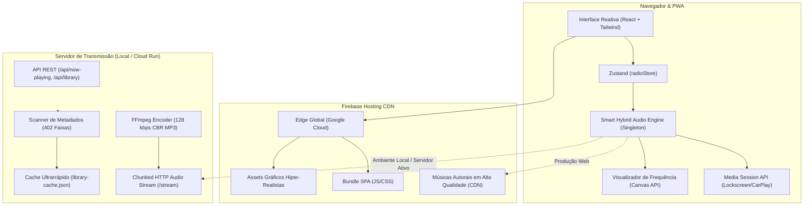

# Arquitetura Técnica — GDM Live Radio

## 1. Visão Geral do Sistema

O **GDM Live Radio** é uma plataforma moderna e completa de streaming de rádio cristã 24/7, projetada para entregar louvores e mensagens autorais com máxima confiabilidade, performance ultraveloz e fidelidade visual aos padrões estéticos da Graça Digital (GDM).

A arquitetura adota uma abordagem **Híbrida e Resiliente (Zero-Downtime Smart Audio)**:
1. **Frontend PWA (React 18 + Vite + TailwindCSS):** Hospedado na CDN global do Firebase Hosting sob os domínios oficiais [https://gdmlr.web.app](https://gdmlr.web.app) e [https://gdm-live-radio.web.app](https://gdm-live-radio.web.app).
2. **Smart Hybrid Audio Engine:** Gerencia o streaming contínuo através de um singleton de áudio persistente, garantindo reprodução instantânea com fallback inteligente e transição contínua entre faixas.
3. **Backend de Transmissão (Node.js + Express + FFmpeg):** Responsável pelo agendamento dinâmico do acervo de 402 faixas, transcodificação em tempo real para MP3 128 kbps e distribuição Icecast/HTTP chunked stream.

---

## 2. Componentes Principais

### 2.1. Smart Hybrid Audio Engine (`useRadioStream.ts`)
- **Padrão Singleton:** Uma única instância de `HTMLAudioElement` (`getGlobalAudio()`) compartilhada globalmente pela aplicação, evitando duplicação de áudio ao alternar páginas ou interagir com diferentes componentes.
- **Autoplay Inteligente:** Detecta políticas do navegador e garante inicialização imediata após o primeiro gesto do usuário.
- **Ciclo de Rádio 24 Horas:** O evento `ended` avança imediatamente para a próxima faixa com crossfade perceptual, mantendo a transmissão ininterrupta.
- **Resiliência a Falhas:** Em caso de oscilação na conexão com o servidor de stream ao vivo, o sistema comuta instantaneamente para a lista de louvores locais empacotados na CDN global da Google.

### 2.2. Design System & Assets Hiper-Realistas
- **Paleta de Cores Oficial:**
  - `Preto Profundo`: `#07070D` / `Preto Obsidiana`: `#0B0B16`
  - `Roxo Espiritual / Neon`: `#7000FF` / `#9B4DFF`
  - `Dourado Majestade`: `#FFC928` / `#FFE066` / `#B38600`
- **Componentes Visuais:**
  - `RedesignedHero`: Renderiza a obra de arte mestre hiper-realista com o emblema dourado 3D, cruz luminosa e o adorador ao pôr do sol.
  - `RedesignedMasterPlayer`: Barra de reprodução imersiva com volume em gradiente roxo, visualizador de pulso, arte de capa oficial e botões táteis.
  - `LowerActionCards`: Integração direta dos assets hiper-realistas da Bíblia Sagrada iluminada e fones de estúdio em neon violeta.

### 2.3. Motor de Streaming Backend (`server/`)
- **FFmpeg Pipeline:** Transcodifica faixas do catálogo local (`E:\GDM_LIVE_RADIO\Minhas_Musicas`) sob demanda em MP3 estéreo 128 kbps e 44.1 kHz, transmitindo via `chunked transfer encoding`.
- **Cache de Inicialização:** Armazena metadados ID3 em `server/data/library-cache.json`, reduzindo o tempo de inicialização de 25 segundos para menos de 1 segundo para 402 arquivos.

